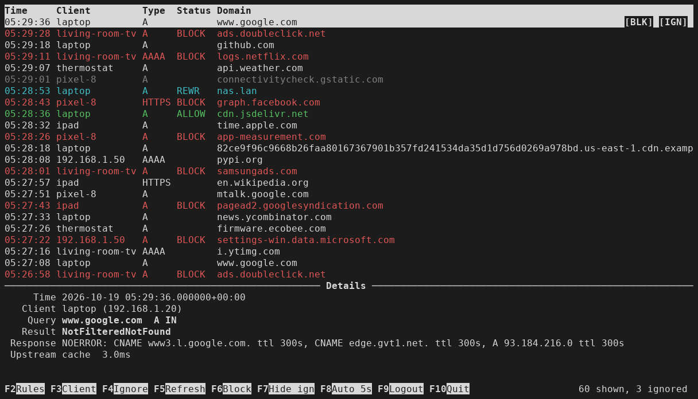

# adguard-manager

A terminal (curses) front end for the [AdGuard Home](https://github.com/AdguardTeam/AdGuardHome) query log and custom filtering rules. Single Python file, standard library only.



## Install

```sh
install -m755 adguard-manager ~/.local/bin/
adguard-manager
```

Needs Python 3.9 or newer. The first start asks for the server URL (default `http://adguard.lan`), username and password.

## Keys

All commands are on function keys, so typing always filters.

| Key | Main list | Custom rules (F2) |
|-----|-----------|-------------------|
| F2  | open the custom rules manager | back (asks to submit changes) |
| F3  | show one client (pick from a list) / all clients | |
| F4  | ignore a domain or subdomain (hide it in the list); on a greyed (ignored) row: un-ignore it. Last menu item: list of ignored domains (Enter removes) | edit rule |
| F5  | refresh | reload |
| F6  | block / unblock the selected query, block its answer IPs or CNAMEs, or remove its blocking rule; again = undo | |
| F7  | show / hide ignored queries (greyed out; hidden at start) | add rule (at the end) |
| F8  | auto-refresh interval: 5s, 10s, 30s, off | delete rule (also Delete) |
| F9  | log out (asks first) | |
| F10 / Ctrl+Q | quit | back (asks to submit changes) |

Typing filters the list (domain, client name or IP), Backspace edits, Esc clears. Up/Down, PgUp/PgDn, Home/End move. On the selected row, Left picks the client and Right picks the whole domain, then each Right a shorter part of it (stops at example.com), and Left a longer part again, then the client; the pick is bold. While showing one client, Left on the picked client shows all clients again (like F3), staying on the same query. Enter on a picked client shows only that client; Enter on a picked domain part opens a Block/Unblock, Ignore/Unignore menu for it; Enter with nothing picked asks Block or Ignore, then shows that key's usual list. In popups Enter chooses, Esc cancels; typing filters there too.

Mouse: click a row to select it, click its [BLK]/[UBLK] or [IGN] button to press F6 or F4, click its client to show only that client, click a part of its domain to pick it to the end, shown in bold (clicking "cdn" in ads.cdn.example.com picks cdn.example.com), so F4/F6 use it without asking (click it again for a Block/Unblock, Ignore/Unignore menu; click elsewhere on the row to clear it), the wheel moves the selection, click a footer key to press it, click an item in a popup to choose it, click outside a popup to cancel it. Hold Shift to select text with the mouse.

Custom rules (F2): Enter, or a click on the selected rule, asks Edit or Delete. Esc clears the filter, or goes back when there is none.

## How it works

- **Login:** `POST /control/login`. Only the `agh_session` cookie is stored, never the password, in `~/.config/adguard-manager.json` (JSON, mode 600). When the session expires you are asked again.
- **Few disk writes:** the config file is written at login, and on exit only if the ignore list or the client filter changed (or you logged out). Refreshing writes nothing.
- **Little network traffic:** the first load fetches 20 entries (fills the screen), then pages of 100 up to 500 between keypresses. Refresh (F5, or automatic every 5s) asks for 20 entries and stops at the first one it already has; longer gaps take bigger pages. New entries are added on top.
- **Block/unblock (F6):** edits the custom filtering rules. Unblock removes a matching `||name^` rule, and adds `@@||name^` if the name is still blocked; block works the other way. You choose the level (`ads.x.example.com`, `x.example.com` or `example.com`, each with its subdomains). The row then shows AdGuard's current verdict (`/control/filtering/check_host`) and the details keep the original one. Unblock first offers to remove the custom rule that blocked the query, if it is still there. Block also offers the query's answer IPs as the last item: it adds `||ip^` for each A/AAAA answer not already blocked, which blocks any response carrying that IP. Each answer CNAME's levels are offered too, and with several CNAMEs an item blocks them all (`||cname^` each). F6 again on the same row undoes exactly what it did.
  Note: AdGuard's check is by name only, so rules that match answer IPs or CNAMEs are not applied in it.
- **Ignore (F4):** hides queries in this app only; AdGuard keeps logging them.
- **Custom rules (F2):** the rules in stored order (new rules are appended, so oldest first). Edits, adds and deletes stay local until you go back (F2, F10 or Esc), which asks Submit changes? Yes / No (discard) / Cancel (stay). Submitting re-reads the list from the server first; if it changed meanwhile in the web interface, your edits are replayed on it by rule text, so both are kept.

Tested with AdGuard Home v0.107.79.

## License

GPL-3.0, see [LICENSE](LICENSE).
